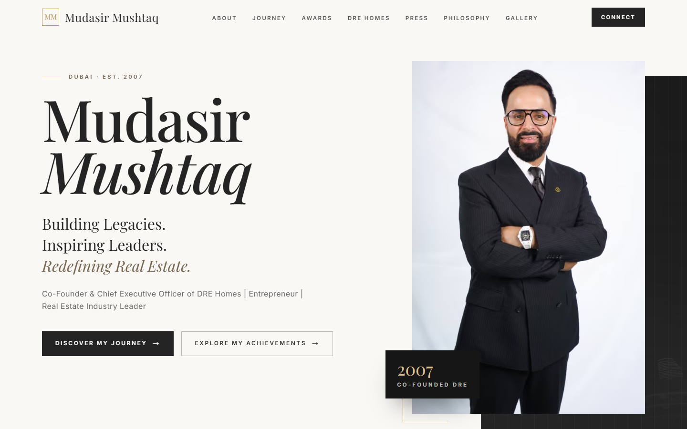

# Mudasir Mushtaq — Personal Branding Website

Premium editorial website for **Mudasir Mushtaq**, Co-Founder & Chief Executive Officer of DRE Homes Real Estate, Dubai.

**Stack:** Next.js 15 (App Router) · TypeScript · Tailwind CSS v4 · Motion · Zod · Resend (email via REST)



## Getting started

```bash
npm install
cp .env.example .env.local   # fill in values
npm run dev                   # http://localhost:3000
```

| Script | Purpose |
| --- | --- |
| `npm run dev` | Local development |
| `npm run lint` | ESLint |
| `npm run typecheck` | TypeScript (`tsc --noEmit`) |
| `npm run build` | Production build |

## Environment variables

| Variable | Required | Description |
| --- | --- | --- |
| `NEXT_PUBLIC_SITE_URL` | Production | Final approved domain. Drives canonical URLs, sitemap, robots and Open Graph. Falls back to the Vercel URL. |
| `RESEND_API_KEY` | For contact form | Resend API key (server-only). |
| `CONTACT_TO_EMAIL` | For contact form | Recipient(s), comma-separated. |
| `CONTACT_FROM_EMAIL` | For contact form | Verified Resend sender, e.g. `Mudasir Mushtaq Website <enquiries@domain.com>`. |

If the email variables are missing, the form validates normally but the API returns `503` with a friendly message.
Spam protection: hidden honeypot field, minimum fill-time check, per-IP rate limiting and server-side Zod validation.

## Site structure

Hero · Meet Mudasir · My Journey · Awards & Achievements · Building DRE Homes · Media & Press · Leadership Philosophy ·
Photo Gallery · Connect · Footer — plus `/privacy`, `/robots.txt`, `/sitemap.xml` and Person / RealEstateAgent / WebSite
JSON-LD (Person includes `alternateName: "Mudasir Wani"`).

## Updating content

All copy and data live in `src/content/` — no component changes required.

| File | What it controls |
| --- | --- |
| `site.ts` | Name, alternate name, title, tagline, navigation, **social links** (only add verified profiles) |
| `awards.ts` | `personalAwards` (given to him by name), `companyAwards` (DRE highlights) and `developerAwards` (year-by-year DRE honours; totals are computed automatically) |
| `press.ts` | Media & Press cards. `date` and `url` are optional — omit them when not verified |
| `story.ts` | Journey timeline, verified quotations, leadership philosophy, gallery images |
| `sources.ts` | Every source URL referenced on the site |

Images go in `public/images/`. For gallery items set `focus` (CSS `object-position`) to keep faces in frame, and
`width`/`height` to the real pixel size. Only add **verified** facts and quotations — each award, milestone and quote must
reference a URL in `sources.ts`. Company awards must never be presented as personal awards.

## Verified sources

- DRE Homes (About Us / Management, "Our Awards" listing) — https://www.drehomes.com/
- Gulf News, GN Focus "Benchmarking Success" — "Stay Focused on Personalised Service" (30 Sep 2024) — https://gulfnews.com/gn-focus/for-dre-its-all-about-staying-focused-on-personalised-service-1.1727687083694
- Gulf News, Black Onyx Platinum Award (27 Sep 2024) — https://gulfnews.com/gn-focus/dre-awarded-prestigious-black-onyx-platinum-award-by-dubai-holdings-1.1727429139243
- Property Time, "Trust & Transparency: DRE's 18-year-old Legacy" (Oct 2025) — https://www.propertytime.ae/featured/trust-transparency-dres-18-year-old-legacy/
- Estate Magazine (Dubai Hills Estate HQ, 2025) — https://estatemagazine.ae/kurat-ul-ain-inspires-success-in-dubai-real/
- Bayut TruBroker™ campaign creative and billboard — client-supplied (no public URL yet)
- Hero skyline (`public/images/dubai-skyline.jpg`, greyscaled) — "Burj Khalifa skyscraper illuminated at night" by raghul ayyasamy, Unsplash License — https://unsplash.com/photos/burj-khalifa-skyscraper-illuminated-at-night-uuXaTSeuRVU

Quotations used (verbatim, Gulf News 30 Sep 2024, credited there as "Mudasir Wani (MW)"):
"Organisations are always built on people, processes and values." · "Innovation is a way of life today."

## Outstanding approvals / content gaps

- **DRE management profile URL** for Mudasir Wani was not verified (live web research was unavailable during the build). `sources.dreAbout` currently points to the DRE homepage — replace it with the exact About / management URL.
- **Office portrait** (bookshelf with awards) — original file needed; About uses the co-founders photo as a placeholder (see `TODO` in `About.tsx`).
- **Designation** "Co-Founder & Chief Executive Officer" — final client sign-off.
- **Bayut TruBroker™** award year and a public source URL.
- **Image consent:** Bayut billboard shows other brokers; DRE cricket team photo shows other people. Gulf News spread artwork usage rights.
- **Dubai Hills Estate HQ year (2025)** sourced from Estate Magazine — confirm.
- **Additional personal awards** — none confirmed by name yet. The Arabian Business "Real Estate Legends #22" ranking belongs to Qurat Ul Ain and is excluded.
- **Social handles** — none verified, so only the DRE Homes website is linked.
- **Video**, award-ceremony, HQ and event photography for the gallery.
- **Privacy policy** is a draft pending legal review.
- **Domain** and contact-form recipient / Resend key to be configured.
